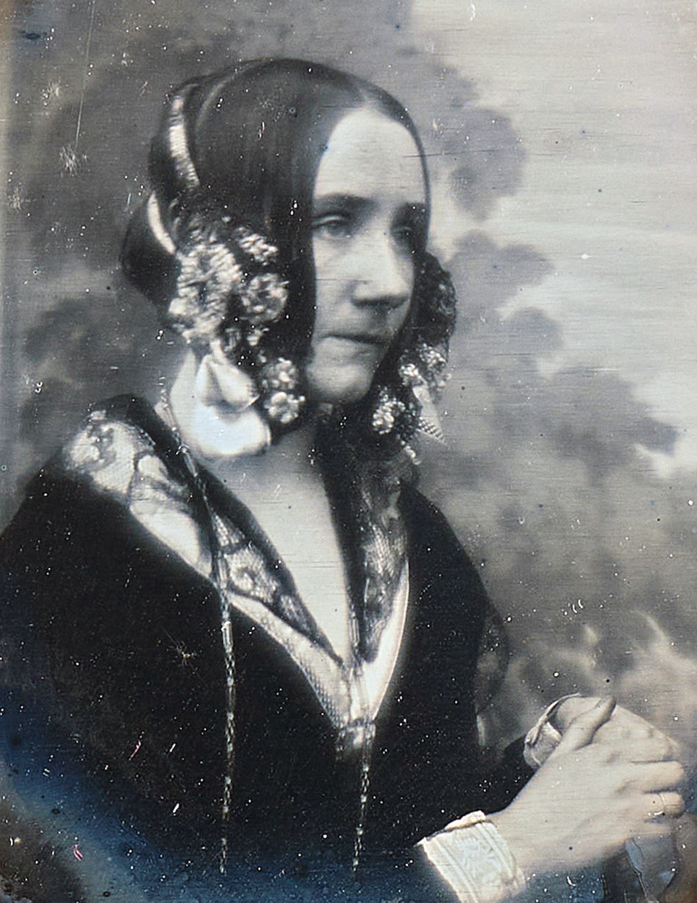
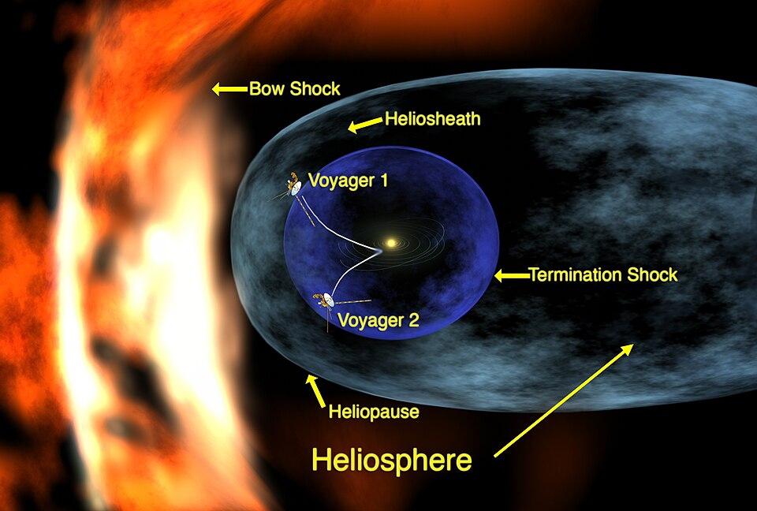

[← Volver al inicio](README.md)
# Temas del curso

### 16/09 · Mis aficiones

Llevo practicando tenis desde los seis años ya que toda
mi familia lo jugó en algún momento de sus vidas. Lo que más
me gusta es el momento en que por fin corriges un error
que te pasaba factura y comienzas a ver un progreso rápido.
Aunque jugar a veces sea frustrante, para mí es una forma
de desconectar del día a día y solo pensar en el presente.

Buscando en GitHub he encontrado [tennis_analysis](https://github.com/abdullahtarek/tennis_analysis),
un programa libre que analiza a los tenistas en un vídeo para estudiar su velocidad, potencia de tiro y cantidad de golpes.

---

### 28/09 · Premios Princesa de Asturias: Leo Messi

El futbolista argentino Lionel Messi será premiado con el Premio Princesa
de Asturias de los Deportes 2026 por la Fundación Princesa de Asturias.
[Su página en la Fundación](https://www.fpa.es/es/premios-princesa-de-asturias/premiados/2026-leo-messi/?texto=trayectoria)
Será galardonado por su labor tanto profesionalmente como socialmente, 
ya que se preocupó de forma activa por la salud y la educación de los
niños desfavorecidos. Le elegí porque es una persona muy influyente
actualmente que transmite valores positivos como el esfuerzo, la
empatía o la superación personal.

Imagen: Shai Pal, [Wikimedia Commons](https://commons.wikimedia.org/wiki/File:FC_Barcelona_-_Bayer_04_Leverkusen,_7_mar_2012_(07).jpg)

---

### 13/10 · Ada Lovelace

Según National Geographic, Ada LoveLace fue una aristócrata matemática que asentó las
bases de los mundos digitales, sobre todo en el área de la programación. Inventó un 
algoritmo para que una máquina mecánica calcurara unos números, lo que fue considerado
el primer software de la historia.[Ada Lovelace en National Geographic](https://historia.nationalgeographic.com.es/a/ada-lovelace-visionaria-hija-lord-byron_15864)
El Día de Ada Lovelace se celebra el segundo martes de octubre porque su creadora buscaba 
un mes sin vacaciones ni exámenes en el hemisferio norte para que los colegios pudieran
organizar eventos.

{: width="300"}
*Imagen: Antoine Claudet, [Wikimedia Commons](https://commons.wikimedia.org/wiki/File:Ada_Lovelace_daguerreotype_by_Antoine_Claudet_1843_-_cropped.png))*

---

### 22/11 · Voyager 1

La Voyager 1 es una sonda espacial enviada por la NASA el 5 de septiembre de 1977 para 
investigar los planetas Júpiter y Saturno.[Voyager 1 en Wikipedia](https://es.wikipedia.org/wiki/Voyager_1)
Hoy en día, es el objeto humano que más distancia ha recorrido en el espacio y salió de
la zona de influencia del Sol en 2012. Volvió a ser noticia en noviembre de 2026 por 
alcanzar una distancia de 24 horas luz de la Tierra. Como dato curioso transporta un 
disco de oro con sonidos e imágenes de la humanidad.

| Dato | Voyager 1 |
|---|---|
| Lanzamiento | 05/10/1977 |
| Distancia a la Tierra | 25.902 millones de kilómetros |
| Velocidad | 61.155 km/h |
| Lo que tarda su señal en llegar | 24 horas |
| Años de viaje | 49 años |

{: width="300"}
*PIE DE FOTO. Imagen: NASA/Walt Feimer, [Wikimedia Commons](https://commons.wikimedia.org/wiki/File:Voyager_1_entering_heliosheath_region.jpg)*

**Mi Disco de Oro 2026**

- **Lo que pondría:** El himno de Asturias.
- **En qué idioma:** Español.
- **En qué formato:** WAV.

---
